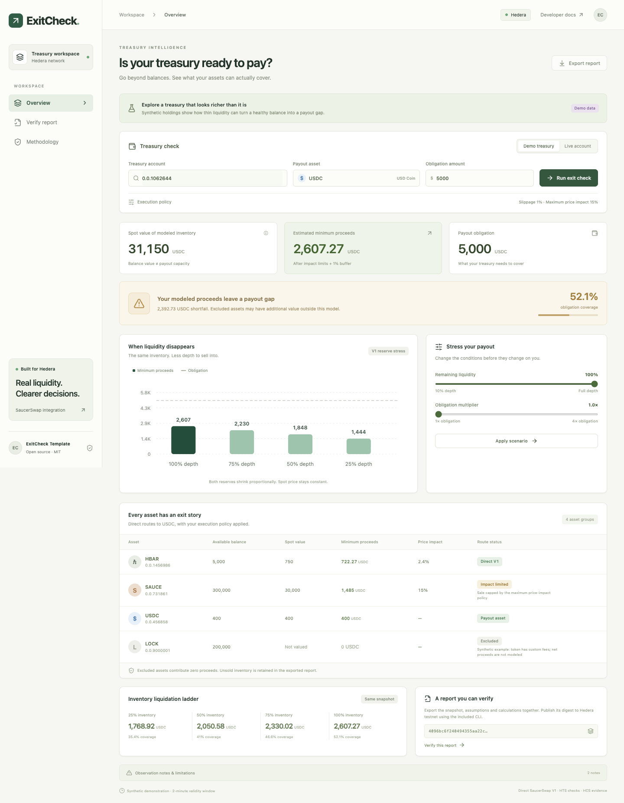

# ExitCheck

**Can this treasury actually cover its next payout?**

ExitCheck is a Scaffold-HBAR community template for liquidity-aware treasury analysis. It combines Hedera balances and HTS transfer restrictions with real SaucerSwap V1 pool reserves and router quotes, then estimates payout coverage under an explicit execution policy. Export a reproducible report and publish its digest to Hedera Consensus Service on testnet.



A balance marked at the pool's spot ratio can look healthy while its actual liquidation proceeds fall far below the next obligation. ExitCheck makes that difference visible.

## Start in two minutes

Requirements: Node **20.18.3 or later**, npm, Git. Node 22 or 24 LTS is recommended. No wallet, faucet, API key or environment file is required for the demonstration.

```sh
npm ci
npm run dev
```

Open **http://localhost:3000**. The initial treasury is explicitly synthetic. It shows a thin SAUCE pool, a usable HBAR balance, existing USDC, and an excluded custom-fee token. Try an obligation of `1000`, then `5000`. Move remaining liquidity to 25% and apply the scenario. Export a report, open **Verify report**, and check it independently.

### Scaffold this template

After publication:

```sh
npm create scaffold-hbar@latest -- exitcheck --template UncleTom29/ExitCheck --package-manager npm --solidity-framework hardhat --frontend nextjs-app --skip-hedera-skills
cd exitcheck
npm run dev
```

The manifest constrains this template to Next.js, Hardhat and npm. The upstream CLI consumes and removes `template.json` after generation; its presence is required in this source repository, not in the generated app. A root `.env.example` is included manually, so the CLI does not regenerate or strip its configuration defaults.

## Live analysis

Select **Live account**, enter a treasury account ID, the fungible HTS payout token ID, obligation amount in that token's units and an HBAR reserve, then run the check.

Mainnet examples: USDC `0.0.456858`, SAUCE `0.0.731861`, WHBAR `0.0.1456986`. Testnet token IDs differ; testnet WHBAR is `0.0.15058`, SAUCE is `0.0.1183558`. A mainnet USDC ID must not be assumed to represent USDC on testnet. Token symbol and decimals are read from Mirror Node, not hard-coded into live calculations.

```sh
npm run report -- --live --network mainnet --account 0.0.YOUR_ACCOUNT --payout 0.0.456858 --obligation 5000 --out reports/mainnet.json
npm run report -- --live --network testnet --account 0.0.8348691 --payout 0.0.15058 --obligation 100 --out reports/testnet.json
```

No trades are sent. `covered` means **the supported modeled inventory covers the specified obligation under the recorded assumptions**. It does not prove signer access, unlocked inventory or guaranteed execution.

### Configuration

Public Mirror Node and Hashio endpoints work by default. The `.env` file is read by CLI scripts; Next.js reads `packages/nextjs/.env.local` for its server-side overrides. Never prefix signing keys with `NEXT_PUBLIC_`.

| Variable                 | Purpose                                      | Required                       |
| ------------------------ | -------------------------------------------- | ------------------------------ |
| `HEDERA_MAINNET_RPC_URL` | Optional mainnet relay override              | No                             |
| `HEDERA_TESTNET_RPC_URL` | Optional testnet relay override              | No                             |
| `HEDERA_ACCOUNT_ID`      | Testnet account paying HCS fees              | HCS only                       |
| `HEDERA_PRIVATE_KEY`     | Local testnet signing key                    | HCS only                       |
| `HEDERA_KEY_TYPE`        | `ecdsa` (default) or `ed25519`               | HCS only                       |
| `HCS_TOPIC_ID`           | Existing topic the signer may submit to      | Optional with `--create-topic` |
| `HEDERA_EVM_PRIVATE_KEY` | Hex EVM key for optional contract deployment | Contract only                  |

Use a testnet-only signer. Configure it locally in your secret manager or git-ignored `.env`. Private keys never belong in the dashboard, report, evidence file or repository.

## How coverage works

1. Read HBAR and nonzero HTS holdings. Inspect token metadata, account freeze/KYC status, deletion, pause state and custom fees. Unsupported conditions produce explicit exclusions.
2. Keep the requested HBAR fee reserve. Combine native HBAR and eligible WHBAR before quoting their shared direct pool.
3. Discover each direct V1 pair through the SaucerSwap factory. Read `token0`, `token1` and `getReserves` at one pinned RPC block. Cross-check the full-inventory quote against the current V1 router's `getAmountsOut` at that same block.
4. Apply the inventory fraction, remaining-liquidity scenario and maximum price-impact policy. Cap the input analytically to that policy; retain unsold inventory in the report.
5. Round swap proceeds and minimum output down in integer base units. Round multiplied obligations up. Existing payout assets incur no swap fee or slippage deduction.
6. Sum independent direct-pool minimum outputs. Show coverage, shortfall, excluded holdings, inventory liquidation ladder and reserve stress comparison.

For a V1 pool with input reserve `x`, output reserve `y`, and input amount `a`:

```text
net        = a × 9970
output     = floor(net × y / (x × 10000 + net))
impact     = net / (x × 10000 + net)
maxInput   = floor(impactBps × x × 10000 / ((10000 - impactBps) × 9970))
minOutput  = floor(output × (10000 - slippageBps) / 10000)
```

The 30-basis-point V1 fee is checked against the router output for the observed reserves; a mismatch excludes the route. Price impact is measured against the fee-adjusted spot rate, so it excludes the swap fee. Spot inventory value is the reserve-ratio value before swap fees, impact caps or slippage. Excluded assets are **not valued**, rather than assigned a misleading zero market price.

Remaining liquidity scales **both V1 reserves by the same factor**, modeling proportional LP withdrawal without changing spot price. It is not a prediction. Every stress and ladder point is computed from the same snapshot; the ladder varies inventory fraction while preserving the selected liquidity and obligation policy, and the stress chart varies liquidity while preserving selected inventory and obligation policy.

### Result states

- `covered`: minimum modeled proceeds meet the obligation. This remains conditional even when some inventory is excluded.
- `shortfall`: the examined inventory has a modeled gap, without known unexamined/excluded positive holdings.
- `incomplete`: the supported inventory has a gap and other holdings or observations were excluded/unavailable. Additional routes might close it.

The dashboard labels a gap in modeled proceeds; it does not declare an entire treasury insolvent.

## Hedera testnet evidence

A real live-pool report and successful HCS commitment are included in [verified submission evidence](docs/EVIDENCE.md).

The submission requires a real testnet transaction. The workflow creates a submit-key-protected HCS topic and publishes a single small schema-versioned commitment. It records the digest, observation window, treasury account, source network, demo/live mode and EVM observation block. A **mainnet observation can be committed on testnet**; the report source network remains explicit.

Fund a testnet account via the [Hedera Portal](https://portal.hedera.com/). Configure the local signer as described above. Then:

```sh
# Generate a fresh demonstration report, or use the --live example above.
npm run report -- --out reports/report.json
npm run hcs:publish -- --file reports/report.json --create-topic
```

Each submitted transaction is capped at 2 HBAR in fees. Publication writes `evidence/hcs-receipt.json` and `evidence/published-report.json`. The receipt includes topic ID, sequence number, transaction ID, receipt status and actual HashScan/Mirror Node links. These files are ignored by Git until you deliberately copy redacted public evidence into `docs/evidence/` for submission.

Use the topic printed by the first command for future publications (`HCS_TOPIC_ID`), avoiding a new topic each time. The topic's submit key is the configured signer's public key. An existing topic must grant that key permission. An expired report is rejected by default; `--allow-expired` explicitly archives old observations without making them fresh.

**Do not invent a transaction link.** Until a successful receipt and readable Mirror Node message exist, this requirement is pending. Demo commitments are tagged `mode: demo`; they do not turn synthetic balances into live data.

## Independent verification

```sh
npm run verify -- --file reports/report.json
npm run verify -- --file evidence/published-report.json --topic 0.0.YOUR_TOPIC --sequence YOUR_SEQUENCE
```

Local verification checks strict report schema, canonical SHA-256 digest, recalculated results and freshness separately. The browser verifier offers an optional HCS topic/sequence check and expected-payer field. The CLI also accepts `--payer 0.0.EXPECTED_ACCOUNT`. Mirror verification fetches the actual testnet topic message and compares the full commitment metadata to the report. Mirror indexing may take a few seconds after a receipt.

Canonical serialization sorts object keys recursively, keeps array order, and serializes JSON primitives normally. Integer amounts are decimal strings. The envelope digest covers only the versioned `report`, not its own `digest` field. Changing any report field changes the digest. Reordering object keys does not. Unknown report/envelope fields are rejected rather than silently dropped. This is ExitCheck's specified canonical encoding; it is not a claim of RFC 8785 compliance for arbitrary JSON.

HCS establishes consensus ordering and records a publisher's commitment. A matching commitment proves the exported file matches that published statement. It does **not** independently certify treasury inputs or reconstruct the topic's SHA-384 running-hash history. The verifier trusts the queried Mirror Node to serve the network record; users should verify the expected topic, payer/submit authority and explorer independently for higher assurance.

## Optional EVM registry

`packages/hardhat/contracts/ReportAnchor.sol` provides an original, minimal self-attestation registry for integrations that need to query freshness from Solidity. Records are namespaced by publisher and digest, so another publisher cannot occupy your namespace. The registry accepts a nonzero SHA-256 digest with a valid observation window and rejects duplicate publication by an issuer. It is optional; HCS is the primary evidence path.

```sh
npm run contracts:test
# Set HEDERA_EVM_PRIVATE_KEY in your shell before this testnet-only deploy.
npm run hardhat:deploy
```

Hardhat uses the pinned local `solc` package, so compilation does not download compiler binaries. The deployment script logs only the public address and transaction hash. Deploying the registry alone does not authenticate a treasury report.

## Architecture

```text
Next.js dashboard / CLI report
         │
         ├── Mirror Node ── HBAR balances + HTS flags and balances
         └── Hashio RPC ─── SaucerSwap V1 factory, pair, router (one block)
                                  │
                        @exitcheck/core (BigInt)
                                  │
                    versioned report + SHA-256 digest
                         │                  │
               local math verifier     CLI testnet signer
                                            │
                                  HCS topic commitment
                                            │
                                  Mirror message verifier
```

```text
packages/core      schema, integer math, demo fixture, live adapter, tests
packages/nextjs    dashboard, stress UI, HTTP analysis and verification routes
packages/hardhat   optional Solidity registry, offline compiler, contract tests
scripts           report generation, HCS publication, independent verification
```

Signing is intentionally confined to local CLI tooling; no HTTP endpoint exposes a server-funded signer. The web app binds to localhost by default. Hosting publicly requires your own request limits and service operations policy for the read-only analysis endpoints.

## API

| Route               | Purpose                                                               |
| ------------------- | --------------------------------------------------------------------- |
| `GET /api/health`   | Application health                                                    |
| `POST /api/analyze` | Demo/live analysis, report envelope, stress and inventory comparisons |
| `POST /api/verify`  | Strict local envelope and calculation verification                    |

Example:

```json
{
  "mode": "demo",
  "obligation": "5000",
  "slippageBps": 100,
  "maxImpactBps": 1500,
  "liquidityBps": 10000,
  "obligationMultiplierBps": 10000,
  "liquidationBps": 10000
}
```

Analysis requests are limited to 8 KB; report verification to 250 KB. Monetary arithmetic uses BigInt. Display/chart formatting uses ordinary numbers and is not an authoritative calculation.

## Validate

```sh
npm run template:check
npm run check
# With the app running:
npm run smoke
```

Tests cover rounding, large integer balances, fee calculation, impact caps, proportional liquidity withdrawal, HBAR fee reserves, shared HBAR/WHBAR liquidity, cash holdings, missing routes, HTS restrictions, Mirror pagination, forged results, canonical encoding, expiration and issuer-isolated contract publication. CI runs lint, type checks, core tests, contract tests, build and HTTP smoke checks.

### Browser tests

After `npm run build`, install a Playwright browser (`npx playwright install chromium`) and run `npm run e2e`. On a workstation with Chrome installed, `PLAYWRIGHT_CHANNEL=chrome npm run e2e` uses an isolated Chrome test session. Tests cover coverage changes, export, verification, altered-report rejection, stress controls and mobile layout.

## Known boundaries

- **Direct SaucerSwap V1 routes only.** This template does not claim the best market route. V2, V3, multi-hop liquidity, lending positions, staked assets and NFTs are outside scope.
- Inspect at most 12 nonzero HTS holdings and 500 token association records. Truncation is explicit. Extend the adapter with batching if needed.
- Pool EVM reads share a block. Mirror balances and token flags may be observed at different times. Observations expire after two minutes, measured from when collection began.
- Fee reserve is user-selected, not a gas estimator. Network execution fees and wrap costs are outside the quote.
- Freeze/KYC/pause/custom-fee restrictions are screened conservatively. Flags can change after observation; association/approval/signing and treasury encumbrances still require execution checks.
- Native HBAR is modeled through WHBAR liquidity. Existing native HBAR paying a WHBAR obligation still requires wrapping.
- No cached price is substituted when a live quote fails. Unknown tokens and unsupported restrictions are excluded, and result state is incomplete when that exclusion could matter.

## Troubleshooting

| Symptom                      | Resolution                                                                                                                     |
| ---------------------------- | ------------------------------------------------------------------------------------------------------------------------------ |
| Live sources unavailable     | Retry; validate network/token IDs; set an authenticated RPC relay if the public relay rate-limits or lacks pinned-block calls. |
| Some balances excluded       | Open observation notes and token status. The template requires a validated direct V1 route and supported HTS configuration.    |
| Payout asset unsupported     | Choose a fungible token without custom fees or restrictive transfer conditions.                                                |
| File verifies but is expired | Its integrity remains valid; obtain a fresh observation before making a current decision.                                      |
| HCS key failure              | Check local account, key type, funding and submit-key permission. Never paste the key into an issue.                           |
| HCS Mirror message missing   | Wait for indexing, then verify the receipt's topic and sequence again.                                                         |
| `npm ci` disk-space failure  | Free disk space. `npm ci` needs space for dependencies and extraction. Avoid partial installations.                            |

## Sources and maintenance

Canonical deployment IDs were checked against [SaucerSwap contract deployments](https://docs.saucerswap.finance/developers/contracts). The adapter implements [V1 swap quotes](https://docs.saucerswap.finance/developers/v1/swap/swap-quote) and [V1 reserves](https://docs.saucerswap.finance/developers/v1/liquidity/get-pool-reserves). See [Scaffold-HBAR](https://github.com/hedera-dev/scaffold-hbar), [Hedera Mirror Node](https://docs.hedera.com/hedera/sdks-and-apis/rest-api) and [the bounty brief](https://hedera.com/blog/scaffold-hbar-template-bounty/).

This repository contains original application and contract code under MIT. It calls SaucerSwap's interfaces and does not vendor or relicense its contract implementation. No Hedera Harness run was used to generate this project; the included tests and CI are the validation tools.
